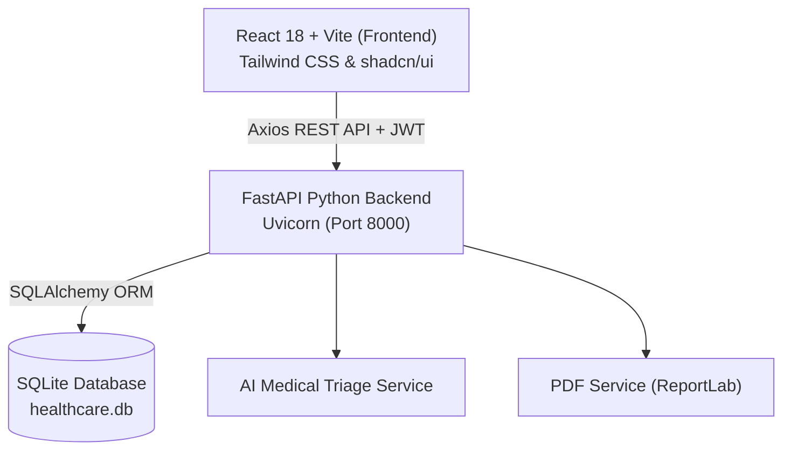

# 🏥 MediCare — Advanced Hospital Management & Telehealth System


**MediCare** is a modern, full-stack Hospital Management & Telehealth System designed to streamline healthcare delivery for patients, physicians, and clinical staff. It brings together instant Video Consultations (VC) for minor ailments, comprehensive patient medical history tracking (Electronic Health Records / EHR), AI-driven symptom triage, doctor appointment booking, and automated digital e-prescriptions.

---

## 📑 Table of Contents

- [Overview & Highlights](#-overview--highlights)
- [Key Features](#-key-features)
  - [1. VC (Video Consultation) for Minor Health Problems](#1-vc-video-consultation-for-minor-health-problems)
  - [2. Comprehensive Patient History & Profile](#2-comprehensive-patient-history--profile)
  - [3. Dual-Mode Appointment Booking](#3-dual-mode-appointment-booking)
  - [4. Specialist Doctor Directory](#4-specialist-doctor-directory)
  - [5. 24/7 AI Medical Assistant](#5-247-ai-medical-assistant)
  - [6. Digital Reports & PDF Medical Passport](#6-digital-reports--pdf-medical-passport)
  - [7. Dark / Light Themes & Accessibility](#7-dark--light-themes--accessibility)
- [System Architecture & Tech Stack](#-system-architecture--tech-stack)
- [Project Directory Structure](#-project-directory-structure)
- [Prerequisites](#-prerequisites)
- [Installation & Run Guide](#-installation--run-guide)
  - [Running the Frontend (Vite + React)](#1-running-the-frontend)
  - [Running the Backend (FastAPI + Python)](#2-running-the-backend)
  - [Quick Test / Demo Mode](#3-quick-test--demo-mode)
- [API Endpoints Overview](#-api-endpoints-overview)
- [Configuration & Environment Variables](#-configuration--environment-variables)
- [Troubleshooting & FAQs](#-troubleshooting--faqs)

---

## 🌟 Overview & Highlights

Modern clinics and hospitals require seamless patient intake and quick remote care for low-acuity problems without clogging emergency rooms. MediCare solves this with:

- **Lightning-Fast Triage**: Direct video consultations for minor issues in under 2 minutes.
- **Robust Clinical EHR**: Complete medical history logs including allergies with severe reaction alerts, past surgeries, vaccinations, and family hereditary risks.
- **Zero-Friction Demo Mode**: Full functionality works with 1-click demo logins even when offline or testing without backend setup.
- **Enterprise UI/UX**: Clean medical design system, accessible color contrast, responsive glassmorphism navbar, and print-ready medical passports.

---

## 🚀 Key Features

### 1. VC (Video Consultation) for Minor Health Problems
*Route: `/vc-appointment`*

Designed specifically for non-emergency, fast-turnaround clinical consultations:
- **6 Minor Problem Categories**:
  - 🌡️ **Cold, Cough & Mild Fever** (sore throat, viral symptoms, low-grade fever < 101°F)
  - 🩹 **Skin Rashes & Minor Allergies** (contact dermatitis, itching, hives, insect bites)
  - 🤕 **Headache & Eyestrain** (tension headache, sinus pressure, screen fatigue)
  - 🤢 **Mild Stomach Upset & Acidity** (indigestion, reflux, mild nausea)
  - 💊 **Prescription Refill & Follow-up** (routine maintenance medications, dosage queries)
  - 👁️ **Minor Eye & Ear Irritation** (pink eye/conjunctivitis, ear fullness, allergic rhinitis)
- **Pre-Call Device Readiness Check**: Verifies network latency, display resolution, microphone input, and camera feed before entering the room.
- **Interactive VC Room**:
  - Dual-view video streaming (Doctor stream + Patient self-view picture-in-picture).
  - Real-time call duration timer.
  - In-call chat messenger for sharing symptoms, photos, or medication names.
  - Live doctor observation notes feed.
  - Call controls: Mute Audio, Toggle Camera, End Consultation.
- **Automated Digital e-Prescription**: Instant post-consultation diagnosis, medication schedule with dosage, and lifestyle counsel saved directly to the patient's record.

### 2. Comprehensive Patient History & Profile
*Route: `/medical-profile`*

A hospital-grade Electronic Health Record (EHR) view:
- **Severe Allergy Alert Banner**: Prominently highlights critical drug allergies (e.g., *Severe Penicillin / Beta-lactam anaphylaxis warning*) at the top of the profile to safeguard clinical decisions.
- **Vitals & Metrics Card**: Displays height, weight, blood group, emergency contact, and auto-computed **BMI** with color-coded status badges (`Normal`, `Overweight`, `Underweight`, `Obese`).
- **Structured History Categories**:
  - **Medical Conditions**: Chronic illnesses (Asthma, Hypertension, Diabetes) with diagnosis dates and status (`Controlled`, `Active`, `Resolved`).
  - **Surgeries & Hospitalizations**: Past procedures with dates, hospitals, and recovery status.
  - **Allergies & Sensitivities**: Food, drug, and environmental allergens with severity levels.
  - **Family Medical History**: Hereditary risks (cardiovascular, diabetes, oncological).
  - **Immunization & Vaccinations**: Doses, booster dates, and 10-year validity tracking.
- **Dynamic History Logging**: Patients can add or remove medical history entries on the fly through an intuitive modal with persistent storage.
- **Export Medical Passport**: 1-click print and PDF export formatted for medical referrals and travel.

### 3. Dual-Mode Appointment Booking
*Route: `/appointments`*

- **Tab 1: VC Video Consult (Quick Care)**:
  - Choose minor problem tags, review typical durations (10–15 mins), and book an immediate telehealth slot or launch the live VC room directly.
- **Tab 2: In-Clinic Hospital Visit**:
  - Select doctor, clinic department, calendar date, and convenient morning/afternoon time slot.
- **Booking Confirmation Modal**: Displays complete booking breakdown with 1-click links to join the virtual room, review consultation history, or view profile.

### 4. Specialist Doctor Directory
*Route: `/doctors`*

- Filter physicians by **All**, **Available for VC**, or **In-Person**.
- Displays verified credentials (MD, MS, FACP, DM), medical specialties, years of experience, patient ratings, spoken languages, and consultation fees.
- Direct booking buttons: *"VC Now"* (instant telehealth) and *"In-Person"* (clinic visit).

### 5. 24/7 AI Medical Assistant
*Route: `/chat`*

- Conversational preliminary medical triage assistant.
- Quick prompt chips (*"Cold & mild fever symptoms"*, *"Minor skin rash & itching"*, *"Start instant VC appointment"*).
- Smart clinical advice with precautions, home remedies, and immediate referral to human doctors or emergency services.

### 6. Digital Reports & PDF Medical Passport
*Routes: `/medical-form`, `/my-reports`, `/my-consultations`*

- Generate styled clinical health assessment reports.
- Client-side PDF rendering using `jspdf` and `html2canvas`.
- Backend PDF generation engine using Python `reportlab`.

### 7. Dark / Light Themes & Accessibility
- Smooth dark mode / light mode toggle with persistent local preference.
- Font scaling, high-contrast modes, and accessible focus states across all forms and dialogs.

---

## 🛠️ System Architecture & Tech Stack



### Frontend
- **Framework**: React 18 with TypeScript
- **Bundler & Dev Server**: Vite 5
- **Styling**: Tailwind CSS 3 with CSS Variables & Glassmorphism
- **UI Components**: Radix UI primitives / shadcn/ui
- **Icons**: Lucide React
- **Notifications**: Sonner & Radix Toaster
- **Forms & Validation**: React Hook Form + Zod
- **Routing**: React Router DOM 6
- **PDF Generation**: jsPDF + html2canvas

### Backend
- **Framework**: FastAPI (Python 3.10+)
- **ASGI Server**: Uvicorn
- **ORM & Database**: SQLAlchemy + SQLite (`healthcare.db`)
- **Authentication**: JWT Bearer Tokens (`python-jose`) + Password Hashing (`passlib[bcrypt]`)
- **Data Validation**: Pydantic v2
- **PDF Engine**: ReportLab

---

## 📁 Project Directory Structure

```text
clinic-dash-demo-main/
├── backend/                        # FastAPI Backend Application
│   ├── ai/                         # AI chatbot logic
│   │   └── chatbot.py
│   ├── models/                     # SQLAlchemy Database Models
│   │   ├── user.py                 # Users & Roles (Patient / Doctor / Admin)
│   │   ├── profile.py              # Patient profile & medical history
│   │   ├── consultation.py         # In-Clinic & VC consultations
│   │   ├── report.py               # Medical diagnostic reports
│   │   ├── knowledge.py            # Disease & medicine database
│   │   └── chat.py                 # Chat message logs
│   ├── routes/                     # API Route Controllers
│   │   ├── auth.py                 # Signup, login, OTP verification, /me
│   │   ├── patient.py              # Profile CRUD & patient reports
│   │   ├── consultation.py         # VC & clinic consultation booking & advice
│   │   ├── doctor.py               # Doctor dashboard & patient responses
│   │   ├── ai_chat.py              # AI conversational endpoints
│   │   ├── reports.py              # Report generation & upload
│   │   ├── health.py               # Diet plans & vitals
│   │   ├── knowledge.py            # Medical knowledge search
│   │   └── admin.py                # Admin user management
│   ├── services/                   # Business logic (PDF, OTP, Email)
│   ├── utils/                      # Security & JWT helpers
│   ├── database.py                 # Database connection & session factory
│   ├── healthcare.db               # SQLite database file
│   ├── main.py                     # Application entry point & CORS configuration
│   └── requirements.txt            # Python dependencies
│
├── src/                            # React Frontend Application
│   ├── assets/                     # Logos, illustrations & avatars
│   ├── components/                 # Reusable UI & Widget Components
│   │   ├── ui/                     # Radix UI components (dialog, select, input, etc.)
│   │   ├── Navbar.tsx              # Navigation bar with consult dropdown & auth
│   │   ├── DoctorCard.tsx          # Doctor card with VC and In-Person actions
│   │   ├── AppointmentHistory.tsx  # Dashboard appointment summary
│   │   ├── ChatMessage.tsx         # Chat bubble component
│   │   ├── EmergencyButton.tsx     # Floating emergency helpline modal
│   │   └── HealthTipBubble.tsx     # Animated health tips floating bubble
│   ├── contexts/                   # React Context Providers
│   │   ├── AuthContext.tsx         # User authentication & 1-click demo logins
│   │   ├── ThemeContext.tsx        # Dark/light theme state
│   │   ├── ReportContext.tsx       # Diagnostic report state
│   │   └── AccessibilityContext.tsx# Accessibility & font size controls
│   ├── lib/
│   │   ├── api.ts                  # Axios client with offline fallback & demo data
│   │   ├── hospitalData.ts         # Doctor catalog, VC minor problems & history data
│   │   └── utils.ts                # Tailwind merge helper
│   ├── pages/                      # Application Page Views
│   │   ├── Index.tsx               # Homepage with hero stats & quick triage
│   │   ├── Appointments.tsx        # Tabbed booking (VC vs In-Clinic)
│   │   ├── VCAppointment.tsx       # Live VC room & device check for small problems
│   │   ├── MedicalProfile.tsx      # Comprehensive EHR patient history & vitals
│   │   ├── PatientForm.tsx         # Health assessment & profile intake form
│   │   ├── Doctors.tsx             # Doctors catalog with VC filters
│   │   ├── Chat.tsx                # AI Medical Chatbot
│   │   ├── ConsultationRequest.tsx # Text/Specialist consultation request
│   │   ├── MyConsultations.tsx     # Consultation records & e-prescriptions
│   │   ├── MyReports.tsx           # Diagnostic reports list
│   │   ├── DiseaseSearch.tsx       # Disease & medication encyclopedia
│   │   ├── Login.tsx               # Login with 1-click Demo buttons
│   │   ├── Signup.tsx              # Patient registration
│   │   └── Settings.tsx            # Patient settings & preferences
│   ├── App.tsx                     # Route definitions & providers
│   ├── index.css                   # Tailwind styles & theme variables
│   └── main.tsx                    # React DOM root render
│
├── public/                         # Static assets
├── index.html                      # HTML entry with MediCare metadata
├── package.json                    # Node dependencies & npm scripts
├── tailwind.config.ts              # Tailwind CSS configuration
├── tsconfig.json                   # TypeScript configuration
└── vite.config.ts                  # Vite build configuration (Port 8080)
```

---

## 💻 Prerequisites

Ensure you have the following installed on your machine:
- **Node.js**: v18.0.0 or higher ([Download Node.js](https://nodejs.org/))
- **npm**: v9.0.0 or higher (comes with Node.js)
- **Python**: v3.10 or higher ([Download Python](https://www.python.org/downloads/))
- **Git** (optional, for version control)

---

## ⚡ Installation & Run Guide

### 1. Running the Frontend

Open your terminal in the project root directory (`clinic-dash-demo-main`):

```bash
# 1. Install Node dependencies
npm install

# 2. Start the Vite development server
npm run dev
```

The frontend will start instantly at:
👉 **`http://localhost:8080/`** (or the port displayed in your terminal).

#### Other Frontend Commands
```bash
# Production Build (TypeScript compilation + Vite bundle)
npm run build

# Preview Production Build locally
npm run preview

# Run Linter
npm run lint
```

---

### 2. Running the Backend

Open a second terminal window and navigate into the `backend/` directory:

#### On Windows (PowerShell):
```powershell
# 1. Navigate to backend
cd backend

# 2. Create virtual environment (if not already created)
python -m venv venv

# 3. Activate the virtual environment
.\venv\Scripts\Activate.ps1

# 4. Install backend dependencies
pip install -r requirements.txt

# 5. Start the FastAPI server with live reload
uvicorn main:app --reload --host 127.0.0.1 --port 8000
```

> **Tip (PowerShell Execution Policy)**: If you get a script execution policy error when activating `venv`, run:
> ```powershell
> Set-ExecutionPolicy -ExecutionPolicy RemoteSigned -Scope Process
> ```

#### On macOS / Linux:
```bash
# 1. Navigate to backend
cd backend

# 2. Create virtual environment
python3 -m venv venv

# 3. Activate virtual environment
source venv/bin/activate

# 4. Install backend dependencies
pip install -r requirements.txt

# 5. Start FastAPI server
uvicorn main:app --reload --host 127.0.0.1 --port 8000
```

The backend API will start at:
👉 **`http://127.0.0.1:8000`**

Interactive Swagger API Documentation:
👉 **`http://127.0.0.1:8000/docs`**

Alternative ReDoc Documentation:
👉 **`http://127.0.0.1:8000/redoc`**

---

### 3. Quick Test / Demo Mode

You can experience **100% of the platform immediately** without even starting the backend or creating a database:
1. Open the frontend at `http://localhost:8080/`
2. Click **Login** in the top navigation bar.
3. Click either:
   - **👤 Patient Demo**: Logs in as *Yoshitha* with pre-loaded vitals, chronic asthma/hypertension history, severe penicillin allergy alert, and past consultations.
   - **🩺 Doctor Demo**: Logs in as *Dr. Sarah Jenkins* (MD, FACP) with physician permissions.
4. Try out:
   - **⚡ Instant VC**: Go to `/vc-appointment`, pick a symptom, run the device check, join the live call, and receive a digital prescription.
   - **📋 Patient Profile**: Go to `/medical-profile`, add a new medical history entry, review allergies, and click **Export Record** to print.

---

## 📡 API Endpoints Overview

| Method | Endpoint | Description | Access |
|---|---|---|---|
| `POST` | `/auth/signup` | Register a new user | Public |
| `POST` | `/auth/login` | Authenticate user & issue JWT | Public |
| `POST` | `/auth/verify-otp` | Verify email OTP | Public |
| `GET` | `/auth/me` | Fetch currently authenticated user | Protected |
| `GET` | `/doctors` | Get all verified doctors | Public |
| `POST` | `/consultation/request` | Book a consultation (VC or In-Clinic) | Patient |
| `GET` | `/consultation/my-requests` | Get all consultations for current user | Patient / Doctor |
| `POST` | `/consultation/respond` | Doctor provides diagnosis & prescription | Doctor |
| `GET` | `/patient/profile` | Retrieve patient EHR medical history | Patient |
| `POST` | `/patient/profile` | Create patient profile | Patient |
| `PUT` | `/patient/profile` | Update patient profile & history logs | Patient |
| `POST` | `/ai/chat` | Send message to AI Medical Assistant | Authenticated |
| `GET` | `/ai/history` | Get user's AI conversation history | Authenticated |
| `GET` | `/diseases/search` | Search medical knowledge encyclopedia | Authenticated |
| `GET` | `/medicines/search` | Search pharmaceuticals & dosages | Authenticated |

---

## ⚙️ Configuration & Environment Variables

### Frontend (`.env` in root directory - optional)
```env
# EmailJS configuration for automated appointment emails (optional)
VITE_EMAILJS_SERVICE_ID=your_service_id
VITE_EMAILJS_TEMPLATE_ID=your_template_id
VITE_EMAILJS_PUBLIC_KEY=your_public_key
```

### Backend (`backend/.env` - optional)
```env
# SQLite by default; can be changed to PostgreSQL or MySQL
DATABASE_URL=sqlite:///./healthcare.db

# JWT Secret key for token generation
SECRET_KEY=supersecretjwtkeychangeinproduction
```

---

## ❓ Troubleshooting & FAQs

### Q1: The frontend shows "Port 8080 already in use"
**Fix**: Vite will automatically offer the next available port (e.g. 8081). Alternatively, change `port: 8080` in `vite.config.ts` to `port: 3000` or `5173`.

### Q2: Can I use the app without Python installed?
**Yes!** The frontend includes a comprehensive mock and localStorage fallback layer (`hospitalData.ts` and `api.ts`). You can browse doctors, test the live VC room, add patient history entries, calculate BMI, and download PDF reports completely in the browser.

### Q3: How do I reset the SQLite database?
**Fix**: Simply delete `backend/healthcare.db`. When you start the FastAPI backend (`uvicorn main:app --reload`), SQLAlchemy will automatically re-create fresh tables.

### Q4: Camera or microphone permission in the VC room
**Fix**: In the live VC room, MediCare tests actual browser media devices using `navigator.mediaDevices.getUserMedia()`. If you do not have a webcam or deny camera permissions, the platform automatically switches to a high-definition simulated doctor feed so testing is never blocked.

---

## 📄 License

This project is licensed under the MIT License — feel free to use and customize it for educational, personal, or commercial healthcare applications.

---

Developed with ❤️ for better, accessible healthcare.
